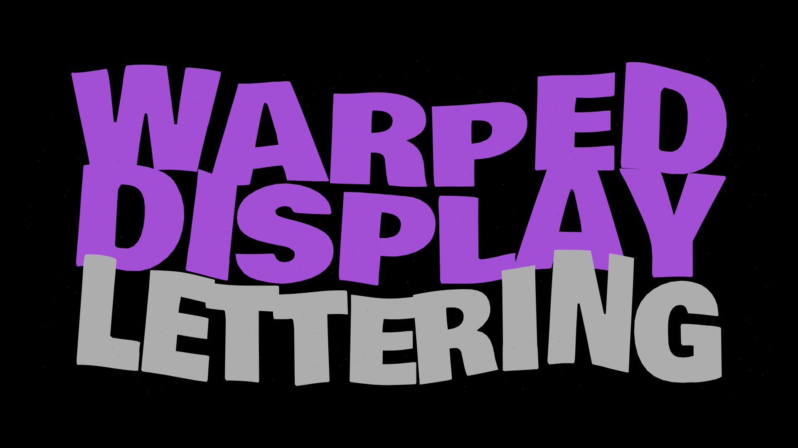
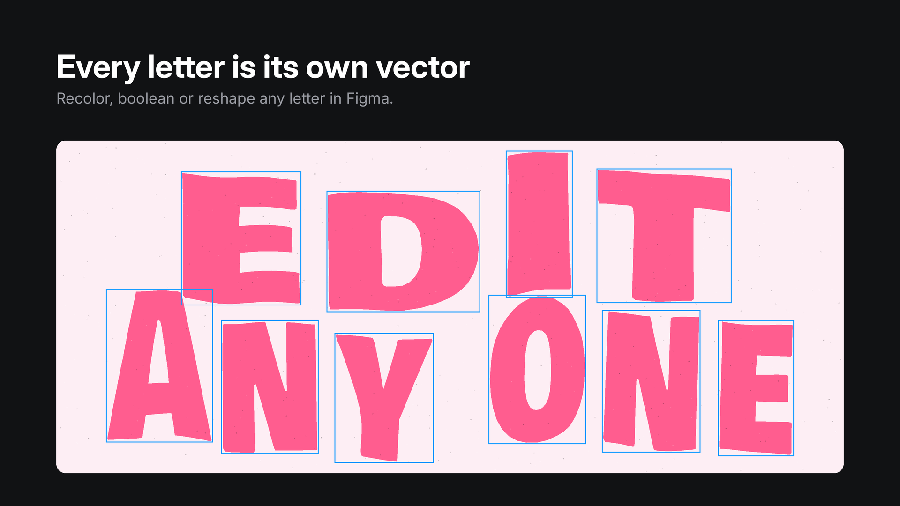
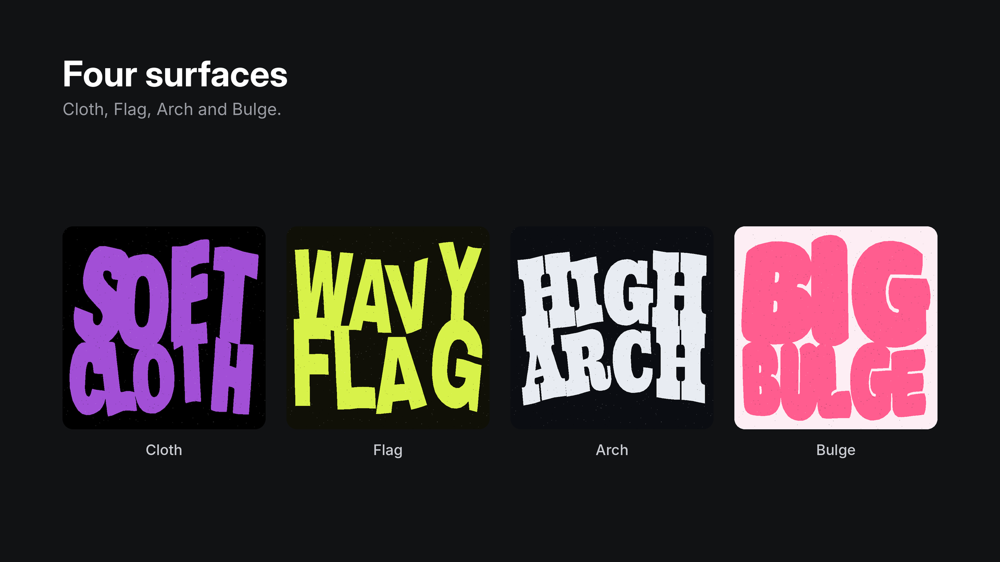
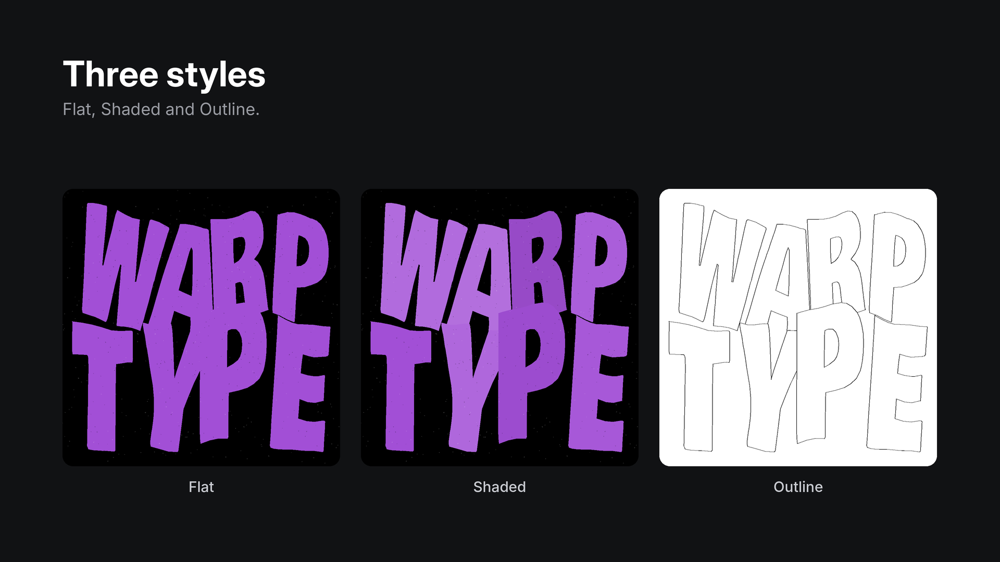
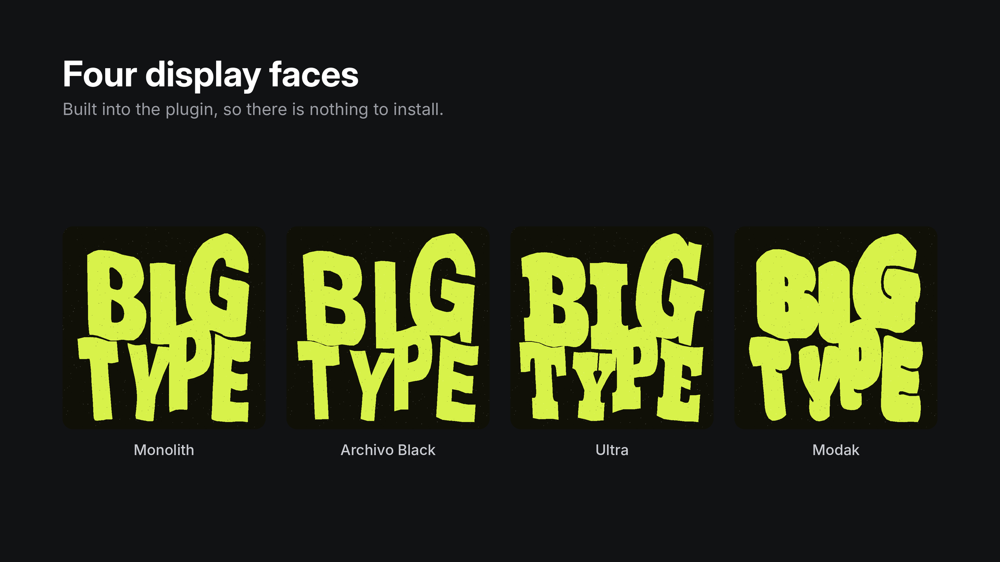

# Warp Type



**Warp display lettering onto rippling cloth. Every letter exports as an editable vector.**

[](https://www.figma.com/community/plugin/1707611803557862644)
[](https://www.figma.com/design/PEUpXwsySU8WC4Jste9Zz9)
[](#license-and-privacy)

Warp Type sets display type onto a rippling cloth surface: the swollen, hand-drawn
register of a 1970s doom-metal sleeve, where fat letterforms bow, lean, swell and crowd
each other as if printed on moving fabric. Every letter is a **closed path** that becomes
an individually selectable VectorNode in Figma, grouped by line, so you can click any
single letter and recolor it after generation.

The engine was built and tuned against Black Sabbath's *Master of Reality* cover, which
is still the shape the default settings produce. The words are changed, since that title
is not ours to ship.

- **Four surfaces:** cloth, flag, arch and bulge, with wave, folds, swell and lean.
- **Three styles:** Flat, Shaded, or black Outline on white, plus 6 curated palettes.
- **Four display faces** baked in as outlines, so letters can bend.
- **Update in place:** change the words or settings later and keep the colors you picked.
- **Reproducible:** the same seed and settings always give the same result.

| | |
|---|---|
|  |  |
|  |  |

## Install

- **From the Figma Community:** [Warp Type](https://www.figma.com/community/plugin/1707611803557862644)
  (in review with Figma; the link works once the listing is approved). Open it in any
  design file and run it from the Plugins menu.
- **Try it first:** duplicate the [Warp Type playground](https://www.figma.com/design/PEUpXwsySU8WC4Jste9Zz9).
- **From source:** see [Development](#development).

## Using the plugin

- **Text**: the words themselves, one per line. Up to 14 lines of 48 characters. If you
  type a character the chosen font doesn't have (accented letters, `{ | } ~`), a note
  under the text box lists what's being skipped.
- **Style**:
  - *Flat*: theme colors, one per line.
  - *Shaded*: the same colors, lightened or darkened per letter by how the cloth under
    it is tipped toward the light. Solid fills throughout, never gradients.
  - *Outline*: black outlines on white, coloring-book style (hides theme, coloring and
    grain).
- **Theme**: 6 curated palettes. A theme's colors are read per line, and repeating a
  color in the list is how a theme groups lines: *Doom* paints lines 1–2 purple and 3–5
  gray exactly the way the sleeve does.
- **Font**: four baked display faces: *Monolith* (fat grotesque with tiny counters, the
  closest match to the sleeve), *Archivo Black*, *Ultra* (fat slab), *Modak* (bubble).
  See [Fonts and licensing](#fonts-and-licensing) for what each is derived from.
- **Fit**: how lines meet the measure, and the whole trick behind the sleeve look:
  - *Stretch*: one cap height for the block, each line's letters **widened or narrowed**
    to fill the width. A five-letter word and a seven-letter word end up the same height
    *and* the same width. A line too short to reach the measure even at full stretch (a
    lone "OF" between long words) gives up some cap height instead of sitting there
    monstrously wide.
  - *Scale*: whole lines resized to fill, so short words tower over long ones.
  - *Plain*: one size, lines centered at their natural width.
- **Surface**: the shape of the cloth: *Cloth* (loose fabric rippling in two
  directions), *Flag* (pinned at the left, waving harder to the right), *Arch* (one clean
  bow across the measure), *Bulge* (a lens pushing out from the center).
- **Wave**: ripple amplitude. **Folds**: how many full waves cross the measure.
- **Swell**: how much the cloth billows toward the viewer, stretching letters vertically.
- **Lean**: how far letters tip with the slope of the surface under them.
- **Jitter**: hand-lettered irregularity: per-letter rotation, baseline bounce and size.
- **Tracking**: letter spacing in % of em; negative crowds letters until they overlap.
- **Leading**: line spacing in % of cap height; negative overlaps lines.
- **Grain**: print speckle. Lands as **two locked layers**, not two thousand nodes.
  Specks over ink mostly go dark (ink breaking up); specks over the background mostly go
  pale (dust). Off in Outline style.
- **Stroke**: outline width (0 = none in the color styles).
- **Size / Seed / 🎲 Shuffle**: same seed + params always reproduces the same result.
- **Insert into Figma** places the frame at the viewport center, named after the words and
  seed, with the background and grain layers locked so clicking a letter never grabs them
  (unlock in the Layers panel to edit). Click any letter to override its fill manually.
- **Update in place**: while a generated frame (or any letter inside it) is selected, the
  button becomes *Update selected*. It regenerates that frame with the current settings
  and keeps any fills you changed by hand on letters that still exist (matched by layer
  name). An *Insert new* button appears next to it for when you want a new frame instead.
  Selecting a frame also loads its stored settings into the panel, the same as the
  **Edit warped type** relaunch button in the properties panel.

The output is vector art, not editable TextNodes; that is the price of warping the
letterforms. Re-edit the words in the plugin panel and push them back with *Update
selected*.

## Relaunch button

Every generated frame gets `setPluginData` (the full parameter set) plus
`setRelaunchData({ edit })`. Selecting the frame shows **Edit warped type** in the lower
right of Figma's properties panel; clicking it reopens the plugin with that frame's
original parameters loaded and the button set to *Update selected*.

> **Plugin id**: `1707611803557862644`, issued by Figma. **Never change it.** Plugin data
> and relaunch buttons are tied to the id, so frames made with another id lose their
> stored settings and their **Edit warped type** button. If you fork this repo and run it
> alongside the original, give your copy a different id, or Figma will treat the two as
> one plugin.

## Development

### Build and import

```sh
npm install
npm run build     # writes dist/code.js, dist/ui.html, dist/core.iife.js
```

Then in **Figma desktop**: Plugins > Development > **Import plugin from manifest…**, then
pick `manifest.json` in this folder. Run it from Plugins > Development > Warp Type.

### Fonts

Warping letterforms needs their outlines, and Figma's font APIs only hand back
TextNodes. So the four faces are baked into the core as path data at build time:

```sh
npm run fonts     # fetch the TTFs, then bake src/core/fonts/*.ts
```

`scripts/fetch-fonts.mjs` downloads each face from the upstream Google Fonts repository
into `fonts/<dir>/` along with its license; `scripts/bake-fonts.mjs` reads them with the
dependency-free TrueType reader in `scripts/lib/ttf.mjs` and emits a glyph table per face
(Latin subset, ~20–50KB each). Both the fetched TTFs and the baked tables are committed,
so a plain `npm run build` never touches the network, and neither does the plugin.

### Dev gallery (no Figma needed)

```sh
python3 -m http.server 8145   # from this folder
# then open http://localhost:8145/preview/gallery.html
```

Renders the default composition big, a 12-tile sweep across faces, styles, fits
and surfaces, and runs automated checks over 41 compositions: determinism (same seed ⇒
byte-identical SVG), every path `Z`-closed, no NaN or Infinity in path data, letter count
matching the input text, and (across every slider extreme, all four surfaces and
degenerate text) that no letter escapes the frame's margins.

### Architecture

One pure core (`src/core/`) produces an SVG string. The plugin UI shows that SVG as the
live preview; `main.ts` inserts the *same* string via `figma.createNodeFromSvg()`, so
preview === output.

- `rng.ts`: seeded PRNG (mulberry32); geometry, color and grain use separate streams, so
  recoloring or dialing grain never moves a letter.
- `fonts/`: baked glyph tables plus the memoized curve flattener that turns a character
  into polygons.
- `layout.ts`: text → glyph polygons placed in the frame, unwarped; owns the three fit
  modes and resamples long edges so stems have points to bend at.
- `warp.ts`: the cloth, as a small sum of seeded plane waves with an **analytic**
  gradient (differentiated rather than sampled twice and divided, which keeps slope exact
  and takes divisions out of the hot path); four surface characters.
- `composer.ts`: params (with defensive clamping) → the warped composition. Each letter
  rides its baseline anchor, then every point picks up the difference between the cloth
  under it and the cloth under the anchor, which is what bends the letterform instead of
  just moving it. A final refit scales the block back inside the margins, so no setting
  can push type off the frame.
- `grain.ts`: print speckle, bundled into two multi-subpath paths.
- `colors.ts`: per-line / per-letter / single fills, plus the shading term.
- `palettes.ts`: 6 curated themes.
- `svg.ts`: composition → SVG string + the layer-name → fill map used to preserve manual
  recolors on update.

## License and privacy

**The plugin's code is MIT. The bundled typeface data is not.** Subsetting a font and
converting its outlines to path data makes a *Modified Version* under OFL 1.1, which
requires the derived material to stay under the font's own license. So `fonts/**`,
`src/core/fonts/*.ts` and the `dist/` bundles that embed them carry the licenses below,
and each generated glyph table repeats its copyright, license and list of changes in a
header comment. See [LICENSE](LICENSE) for the full split.

### Fonts and licensing

| Presented as | Derived from | Copyright | License |
|---|---|---|---|
| **Monolith** | Bowlby One | vernon adams | SIL Open Font License 1.1 |
| Archivo Black | Archivo Black | The Archivo Black Project Authors | SIL Open Font License 1.1 |
| Ultra | Ultra | Brian J. Bonislawsky DBA Astigmatic (AOETI) | Apache License 2.0 |
| Modak | Modak | Ek Type | SIL Open Font License 1.1 |

Bowlby One's grant carries Reserved Font Names (*"Bowlby"*, *"Bowlby One"*,
*"Bowlby One SC"*), and OFL 1.1 does not let a Modified Version use them as the name a
user picks from a menu. The derived subset is therefore presented in the panel as
**Monolith**; it is Vernon Adams' design, credited here and in
`src/core/fonts/monolith.ts`. The other three declare no reserved name and keep theirs.

Full license texts ship in `fonts/<dir>/`.

### Privacy

The plugin declares no network access and collects nothing: no analytics, no accounts,
no third-party services. It reads only the current selection (to recognize frames it
made) and writes only the frames it creates. Each frame carries its own settings as
plugin data so it can be reopened, and that data stays in the Figma file.
